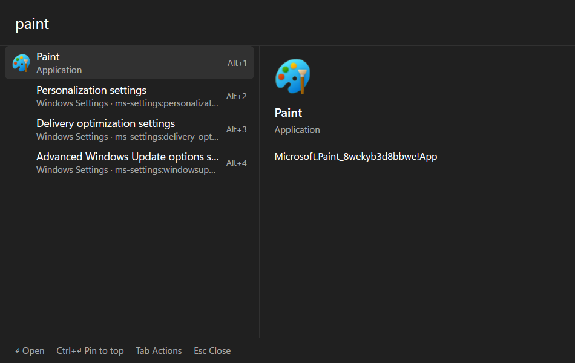
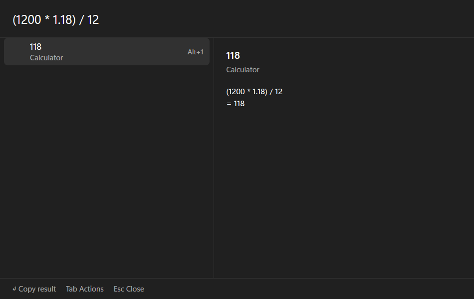
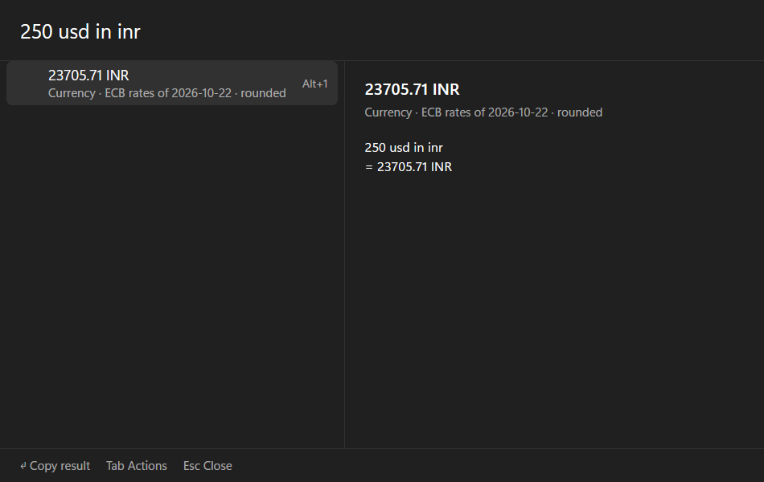
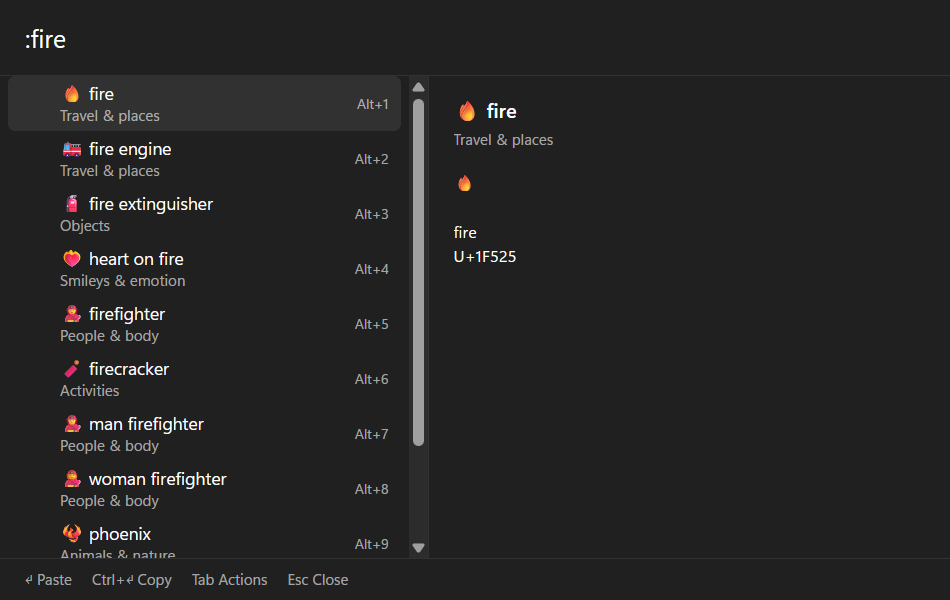
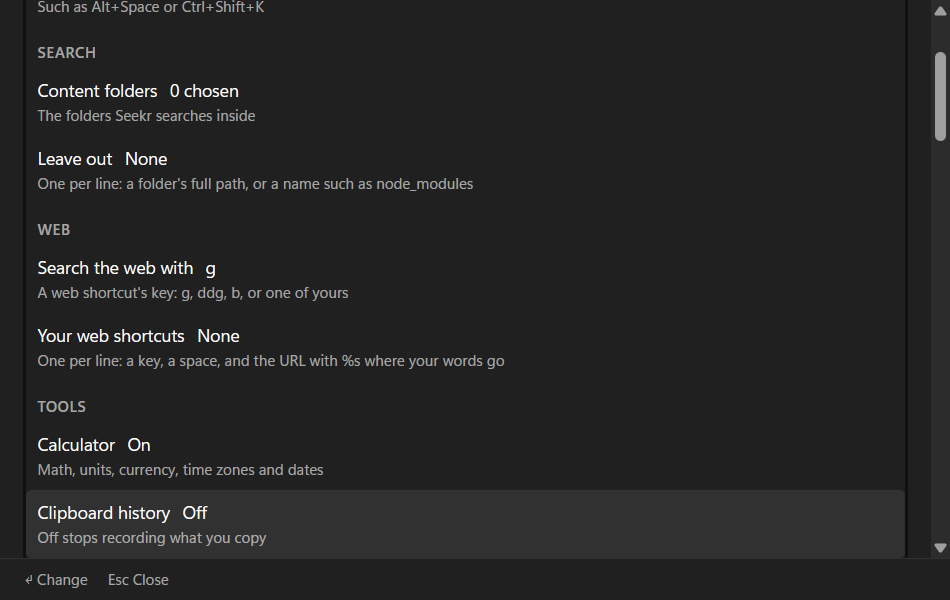

# Seekr

A fast keyboard launcher for Windows: apps, files, file contents and meaning, plus everyday tools, all on one hotkey.

**Status:** before the first release (0.1.0): built from source with `scripts\install.ps1`. Alt+Space opens the search panel: installed apps (Start menu and Store), every file and folder name on your fixed drives, the text inside files in the folders you choose (asked the first time the panel opens), matched by words and by meaning, plus a calculator, clipboard history, a window switcher, system controls, web search, emoji, notes and to-dos, and AI answers about your files from a model on your GPU.

Everything Seekr indexes stays on your PC; [PRIVACY.md](PRIVACY.md) lists what it stores and the few times it uses the network.



## Install

Build and install for daily use. This copies the app to `%LOCALAPPDATA%\Programs\Seekr` (starts hidden at login, power-saving GPU), downloads the meaning-search model (about 750 MB, once) to `%LOCALAPPDATA%\Seekr\models`, and installs the SeekrIndex service to `C:\Program Files\Seekr`, which asks for one UAC approval:

```powershell
scripts\install.ps1             # build, install, start
scripts\install.ps1 -NoBuild    # install the existing target\release build
scripts\install.ps1 -SkipService  # app only, no UAC prompt; C: then uses the slower no-admin scan
scripts\install.ps1 -Uninstall  # remove the app; keeps your data in %LOCALAPPDATA%\Seekr and %APPDATA%\Seekr
```

Then press Alt+Space.

## Search syntax

File names match fuzzily from the second character. Add filters anywhere in the query; they show as chips under the search box, and a chip turns red when its value isn't understood. With only filters, the newest matches come first.

| Filter | Example | Matches |
|---|---|---|
| `ext:` | `ext:pdf,docx` | files with any of these extensions |
| `kind:` | `kind:image` | `folder`, `file`, `image`, `video`, `audio`, `doc`, `code`, `archive` |
| `folder:` | `folder:` | folders only (`folder:music` is the same as `in:music`) |
| `in:` | `in:downloads`, `in:C:\Work` | inside a folder whose name contains the text, or inside that exact path |
| `dm:` / `modified:` | `dm:today`, `dm:week`, `dm:3d`, `dm:2025-05`, `dm:>2025-01-01`, `dm:2025-01..2025-03` | last written in that period (local time) |
| `size:` | `size:>100mb`, `size:<1kb`, `size:1mb..10mb`, `size:empty` | file size; a bare `size:10mb` means at least 10 MB |
| `"…"` | `"read me"` | names containing exactly that text |
| `-` | `-draft` | names not containing that text |

## Calculator

 

Type a calculation and its result comes first; Enter copies it.

| Type | Examples |
|---|---|
| Math, units, bases | `125*48+7`, `sqrt(2)*10`, `5 km to miles`, `255 to hex`, `0xff to decimal` |
| Percentages | `150 + 18%`, `80 - 25%`, `20% of 150` |
| Currency (ECB daily rates, rupees by default) | `10 usd`, `$10`, `250 gbp to eur`, `₹500 to usd` |
| Time zones | `time in tokyo`, `london time`, `3pm ist to pst`, `9am in new york` |
| Dates | `today + 30 days`, `10 days ago`, `days until 25 dec`, `2026-12-25 - today`, `dec 25` |

## Clipboard history

Type `clip ` (with the space) to list what you copied, newest first, or `clip invoice` to find entries containing "invoice". Enter pastes into the window you were in, Ctrl+Enter copies; Tab lists Paste as plain text, Pin and Delete. Into an admin window, Seekr can only copy: press Ctrl+V yourself.

## Window switcher

Type `win ` to list open windows in Alt+Tab order, or `win code` for those whose title or program contains "code". Enter switches; Ctrl+Enter minimizes; Tab adds Close window.

## System controls

Type what you want: `lock`, `sleep`, `restart`, `shut down`, `sign out`, `mute`, `volume up`, `volume 40`, `brightness 70`, `wifi`, `bluetooth`, `dark`, `empty recycle bin`, `close frozen apps`, or any Settings page (`display settings`, `startup apps`). Restart, Shut down, Sign out, Empty Recycle Bin and Close frozen apps ask for a second Enter.

## Web

`g tauri plugins` searches Google, `yt lofi` YouTube, `gh seekr` GitHub (also `ddg`, `b`, `wiki`, `maps`, `amz`, `so`, `r`, `npm`, `crates`, `mdn`, `imdb`, `tr`). Add your own in Settings, or in `%APPDATA%\Seekr\config.toml`:

```toml
search = "ddg"   # the engine for "Search the web"

[shortcuts]
jira = "https://example.atlassian.net/browse/%s"
```

Bookmarks and history from Brave, Chrome and Edge show up as you type; the last row searches the web.

## Emoji and symbols



Type `:` and a word: `:fire`, `:laugh`, `:indian rupee`, `:double arrow`, `:greek small pi`, `:half`. Enter pastes, Ctrl+Enter copies, and Tab lists skin tones where an emoji has them.

## Notes and to-dos

`note pick up the parcel from the post office` saves a note in `Documents\Seekr Notes`; `note` lists recent notes, and Tab → Edit here edits one in place (Ctrl+S saves). `todo call the bank by friday` adds a to-do due on Friday; `todo` shows the list, and Enter marks one done.

## Ask AI

- `?` and a question asks about **your files**: `?when is the rent due`. The answer cites the passages it used; click a number to open that file. A model on your GPU answers, so nothing leaves your PC; it stops after ten idle minutes.
- `??` and a question asks **anything**: `??explain big-O notation`. A cloud model answers, and only what you type after `??` is sent, never your files.
- On a text, Markdown, code, Word, PowerPoint or Excel file, Tab → **Summarize with AI** summarizes it with the model on your GPU; `?` follow-ups then ask about that file. A long file is cut to its first 16,000 characters, and the model is told so.

Follow up with another `?` (or `??`) question; Esc stops an answer.

The model for `?` isn't part of the install. The first time, the `?` row says so: press Enter to download it (llama.cpp's server, its CUDA runtime and Qwen3.5-4B: 3.3 GB, each file checked against its SHA-256). It needs an NVIDIA GPU and takes 3.5 GB in `%LOCALAPPDATA%\Seekr\llm`. Esc stops the download; a stopped file starts over next time.

`??` needs a Gemini or Groq key in your own environment (never in a file you share); both have free tiers:

```powershell
[Environment]::SetEnvironmentVariable('GROQ_API_KEY', 'your-key', 'User')   # or GEMINI_API_KEY
```

With both set, `api = "groq"` in `%APPDATA%\Seekr\config.toml` picks Groq; `api_model` picks the model (defaults: `openai/gpt-oss-120b` on Groq, `gemini-3.5-flash` on Gemini).

## Settings



Type `settings` (or use the tray icon's Settings) for the settings view. Arrow keys move, Enter changes the selected setting (a list, such as your web shortcuts, saves with Ctrl+Enter), and Esc closes it. You can change:
- the hotkey
- the content folders, and folders or names (such as `node_modules`) to leave out of file and content results
- the web search engine and your web shortcuts
- each tool on or off (calculator, clipboard history, window switcher, system commands, web, emoji, notes and to-dos, AI)
- the words that open the clipboard, window, emoji, note and to-do lists
- how long clipboard history is kept, and how many entries
- how long the local AI model stays loaded
- whether meaning indexing runs on battery
- how the panel looks: light, dark or following Windows; the accent color; a Mica, acrylic or solid backdrop and how much of the panel's color covers it; the font and its size; comfortable or compact rows; and the panel's size

At the end of Settings, Maintenance has:
- **Diagnostics:** index counts, recent latencies with a histogram, quarantined files, and the end of the log.
- **Export settings** and **Import settings:** one file with config.toml, your content folders and theme.css. API keys stay in your environment and are never exported.
- **Rebuild the content index** and **Rebuild the file-name index:** each asks for a second Enter first. The file-name rebuild restarts Seekr.

For anything else, Edit theme.css in Settings opens `%APPDATA%\Seekr\theme.css`, your own CSS loaded after Seekr's (the colors are variables such as `--accent` and `--selection`).

Everything is saved to `%APPDATA%\Seekr\config.toml` (your comments in it are kept) and applies at once, without a restart. Editing that file by hand works too: a saved change applies within two seconds, and a mistake shows at the top of the settings view while Seekr keeps the settings it had.

## Accessibility

- Everything works from the keyboard; in an AI answer, Ctrl+1 to Ctrl+9 open its sources.
- Screen readers (Narrator, NVDA) follow the selection: the query box is a combobox over the results list, and the actions menu, settings and folder picker are lists that name the current entry. An AI answer is read once it is written, not word by word; confirmations and errors are announced.
- Windows' high-contrast themes are followed, with the selection outlined in the theme's colors.
- Nothing in the panel moves, and with "Animation effects" off in Windows, motion added by a theme.css is stopped too.

## Develop

Requirements: Windows 11, Rust (stable, MSVC), Visual Studio Build Tools with the C++ workload, Node.js 20+.

```powershell
scripts\dev.ps1     # run the app with hot reload
scripts\check.ps1   # fmt, clippy, tests, cargo-deny, typecheck, vitest, release build, WebDriver smoke test
scripts\smoke.ps1   # just the smoke test, on the last release build
scripts\smoke.ps1 -Script app\e2e\screenshots.mjs   # retake these screenshots (shows the panel; check them before committing)
```

See [CONTRIBUTING.md](CONTRIBUTING.md) for what a pull request needs.

## License

Licensed under either of [Apache License 2.0](LICENSE-APACHE) or [MIT](LICENSE-MIT), at your option. Third-party components and their licenses are in [THIRD-PARTY-NOTICES.md](THIRD-PARTY-NOTICES.md).
